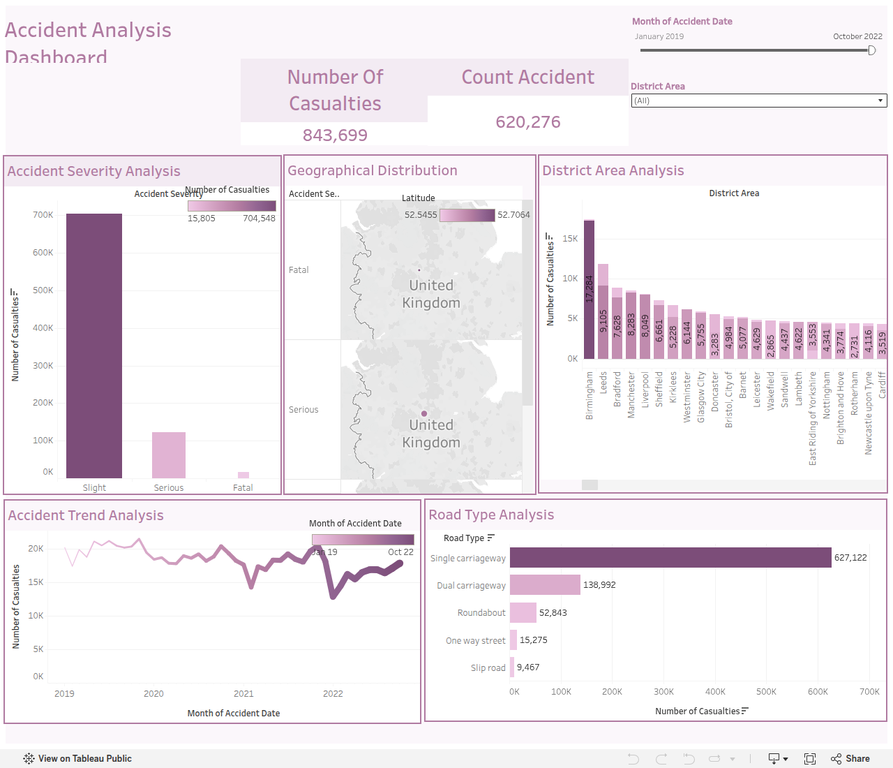

# Road Accident Analysis Dashboard

## Project overview

This project presents an interactive analysis of road-accident data. The dashboard focuses on casualty volume, accident severity, geographic distribution, and changes over time. The objective is to help identify high-risk areas and patterns that can support road-safety decisions.

## Key questions

- How many casualties are recorded, and how does the total change over time?
- Which accident-severity categories contribute most to the total?
- Which districts or geographic areas show higher casualty counts?
- Do the patterns change by year, month, or other available filters?

## Dashboard features

- **Overall impact:** a headline casualty KPI for the selected data.
- **Severity analysis:** comparison of Minor, Serious, and Fatal accident categories.
- **Geographic analysis:** map-based exploration of accident locations and higher-risk areas.
- **Time trends:** accident and casualty patterns across available years and months.
- **District analysis:** comparison of selected districts, including examples such as Manchester and Sheffield.
- **Interactive filters:** filtering by year, region, severity, and other available fields.

## Tools

- Tableau Desktop for data visualization and dashboard development.
- Tableau Public for sharing the interactive dashboard.
- PowerPoint export for presenting the dashboard outside Tableau.

## Repository contents

- `Accident Analysis Dashboard.twb` — Tableau workbook.
- `Accident Analysis Dashboard.pptx` — presentation export of the dashboard.
- `README.md` — project documentation.

## How to view the project

1. Open the Tableau Public link below to explore the interactive dashboard.
2. Use the filters to compare severity, geography, and time periods.
3. To inspect or edit the workbook locally, open the `.twb` file in Tableau Desktop and reconnect the data source if Tableau asks for its original file path.

## Dashboard preview

## Tableau Public

[Open the interactive Accident Analysis Dashboard](https://public.tableau.com/app/profile/shahd.ahmed7387/viz/AccidentAnalysisDashboard_17425834458860/AccidentAnalysisDashboard)

## Portfolio note

This project demonstrates practical skills in exploratory analysis, dashboard design, interactive filtering, geographic visualization, and communicating data-driven road-safety insights.
